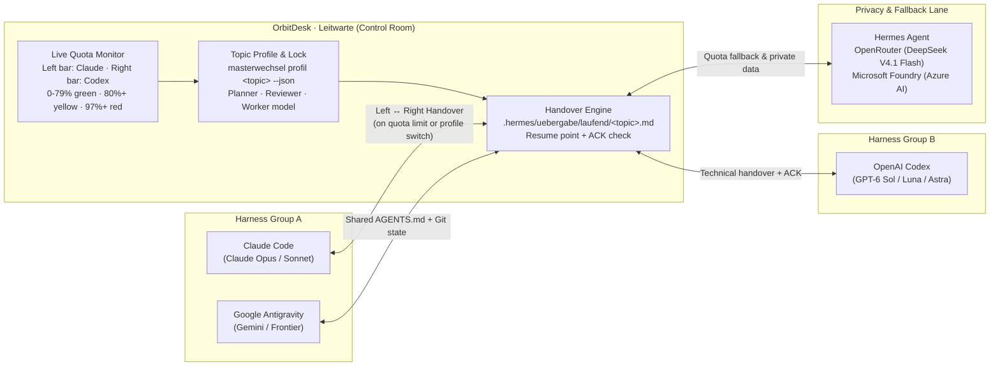
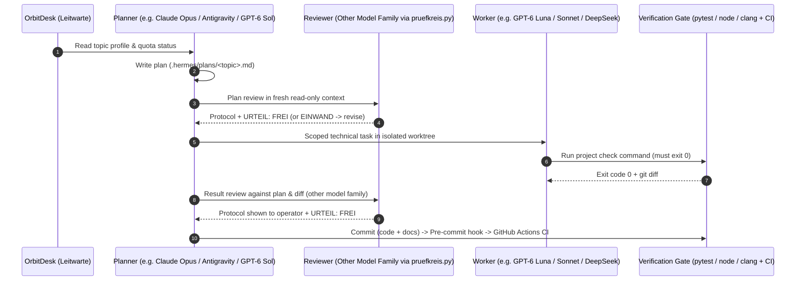

# How I work with AI agents

This is the method behind every project in this repository. It grew out of real problems — each rule below
exists because something went wrong without it. The [Journey](JOURNEY.md) tells the order in which it happened.

---

## 1. Done means verified

Every project has a **check command** with an exit code (for most projects `pytest`). A step is finished when that
command exits with 0 — run fresh, in the same answer that claims it.

Before any statement like “works”, “fixed” or “green”:

1. Which command proves it?
2. Run it, fresh and complete.
3. Read the output and the exit code.
4. Does the output cover the claim?
5. Only then make the claim — together with the evidence.

| Claim | Evidence | **Not** enough |
|---|---|---|
| Tests green | output of the check command, exit 0 | an earlier run |
| Bug fixed | the original symptom checked again | “code changed, should work now” |
| Sub-agent finished | `git diff` shows the change | the sub-agent's success message |
| Requirement met | the plan checked point by point | “tests are green” |

Where a project has no check command, I name the missing one and review every change individually. Inventing a
command that checks nothing would be worse than having none.

**The boundary:** for code on a running PLC there is no such gate — a test run on a live machine is not an option.
There the agent only delivers blueprints, and I apply them myself.

## 2. Rules are wishes, guards are rules

A rule in a Markdown file is a request to the model. What an agent is actually *allowed* to do is enforced by the
harness and by git:

| Layer | Example | Effect |
|---|---|---|
| Rule file | one tool-agnostic core file ([`agent-setup/AGENTS.md`](agent-setup/AGENTS.md), in German as in daily use) read by every agent | describes what the agent *should* do |
| Permission settings | `deny` for private archives, `ask` for force pushes and package publishing, `allow` for git basics and check commands | enforced by the harness in every permission mode |
| Pre-commit hook | runs the check commands for changed Python/Node projects when enabled (`git config core.hooksPath agent-setup/githooks`, using each project's `.venv` or local runtime, while CI runs the full matrix unconditionally); blocks commit identities that GitHub would attribute to a foreign account | applies to every agent and to me, because it is git, not an agent feature |

One source for the rules, no copies: compiled via [`agent-setup/sync-rules.ps1`](agent-setup/sync-rules.ps1), domain files in my workspace only reference the core file, so they cannot drift apart.
→ [Agent setup](agent-setup/)

## 3. Planner, reviewer, workers — across harnesses and model families

I do not lock my workflow to a single vendor or IDE. Instead, a single tool-agnostic rule set ([`AGENTS.md`](agent-setup/AGENTS.md)) and my control-room app **[OrbitDesk (Master-Schalter)](projects/master-schalter/)** (*Leitwarte*) coordinate several agent harnesses and model providers:

| Layer | Tools / Models in daily use | Purpose |
|---|---|---|
| **Control room (*Leitwarte*)** | **[OrbitDesk (Master-Schalter)](projects/master-schalter/)** | Tracks live subscription quotas, stores per-project role/model profiles (`masterwechsel profil <topic> --json`), enforces topic locks, and runs structured handovers between agent harnesses |
| **Agent harnesses** | **Claude Code** · **OpenAI Codex** (CLI & Desktop) · **Google Antigravity** · **Hermes** (open-source agent) | Execute planning, code editing, sandboxed reviews, and isolated worker runs against the same git gates |
| **Frontier & cloud models** | **Claude** (Opus / Sonnet) · **OpenAI GPT-6** (Sol / Luna / Astra) · **Google Gemini** · **OpenRouter** (e.g. DeepSeek V4.1 Flash) · **Microsoft Foundry** (Azure AI Agent Service) | Frontier models for architecture and cross-family review; fast, cost-controlled models for scoped worker tasks and privacy-routed workflows |

| Role | Does | Typical model |
|---|---|---|
| **Planner** | plans, splits the work, accepts results against the plan | the strongest available frontier model |
| **Reviewer** | reviews the plan before building and the result after building | a model from a **different model family** than the planner |
| **Worker** | implements small, explicitly assigned changes | a faster, cheaper worker model |

- Which harness and model take which role depends on the topic profile and which subscription has free quota.
  [OrbitDesk (Master-Schalter)](projects/master-schalter/) is the central *Leitwarte* (control desk) that keeps this state and is being expanded into a full multi-agent orchestration console.
- Reviewer and worker run in **fresh contexts**. The run that built something never approves it.
- **No answer is no approval.** A review that times out or returns no verdict line counts as an error, never as
  approved.
- Private data — personal texts, photos, contacts — is handled by **one dedicated agent only** (Hermes), configured with
  privacy-first routing (`data_collection="deny"` on OpenRouter, or explicitly scoped Microsoft Foundry deployments;
  note that the privacy scan for this portfolio ran under an explicit project-scoped Foundry exception rather than a
  verified zero-data-retention contract). The coding agents get cleaned-up technical tasks and evidence.

## 4. Cross-model review

A model builds, a model from another family reviews, because they have different blind spots. Two design rules:
the reviewer gets the material in the prompt and returns **findings, not decisions**; and the verdict is a fixed last
line that a program can read (`URTEIL: FREI` = approved, `URTEIL: EINWAND` = objection — my tools speak German).

After every round the protocol is shown to me. I am the human in the loop as an **observer**: I see what was
checked and what the planner does with it, without having to carry messages between agents.
→ [Cross-model review](projects/cross-model-review/)

What reviewing taught me, measured on my own code:

1. **Large review scopes lose findings.** Same code, same model: at 27,000 tokens the reviewer reported a severe
   finding; at 62,000 tokens the same finding was missing. Three focused runs beat one run over everything.
2. **Severity labels are unreliable.** The same SQL injection came back as *critical* or *high* depending on the
   model. I re-grade every finding and mark the correction.
3. **An empty protocol is not an approval.** Review finds different things than tests — it does not replace them.
4. **Never suppress error output.** With `stderr` discarded, a quota or authentication error looks exactly like an
   empty result.

## 5. Skills and sub-agents

The critical steps are written as procedures, not slogans: a fixed sequence, a stop criterion, and a table of
typical excuses with the counter-argument.

| Skill | Purpose |
|---|---|
| Root-cause debugging | no fix without a named cause; log what goes in and out at every component boundary; stop after two failed attempts and question the architecture instead |
| Grill me | before building: a register of assumptions to contradict, then one question at a time with concrete options and a recommendation |
| Critic | after building: a second opinion from another model family, findings only |

**Sub-agents** keep throw-away context out of the main conversation: a *researcher* returns file paths and line
numbers instead of file contents, a *tester* returns exit code and failures instead of logs — and repairs nothing,
so the instance that made a mistake does not grade its own result.

## 6. State lives in files

Plans, journals and handover files hold the state of the work — not the context window. That is why clearing the
context costs nothing, and why a task can move from one tool or agent to another in the middle:

- a **plan file** with numbered steps and a check criterion per step;
- a **journal** with every decision and every blocker, including the reason;
- a **handover file** with a resume point, so a restart continues instead of starting over.

**Context is a budget, measured, not guessed.** When my usage quota ran out quickly, the obvious suspect was the
size of the rule files. Measured, everything loaded at session start was 3 % of the context window. The real driver
was the number of turns: my old workflow asked for my approval at every phase boundary, without a single machine
check. Replacing approvals with gates and sub-agents saved far more than shortening files.

## 7. Several agents, one repository

Agents on different machines and sessions work in the same repository. So:

- never “add all” — commits name their files explicitly (`git commit --only <paths>`);
- read the last commits before committing; on a rejected push `git pull --rebase`, **never** `--force`;
- push to `main` only after a green check command; cloud sessions push to their own branches, which are merged
  after a local check.

## 8. Never delete, always reversible

- Agents copy and move; they do not delete — especially on foreign systems (cloud storage, the phone).
- Every write operation on a foreign system goes into a **manifest** (source → target, time, id). How to undo it is
  answered *before* the operation.
- Tools are **idempotent**: running them twice does no harm (existing target = skip).
- Long autonomous runs start from a plan file, verify and commit every step individually, and record blockers
  instead of stopping.

## 9. Code and docs in the same commit

Every change to code, tools or configuration updates the matching documentation in the same commit. The
documentation describes the *new* state — and must not claim anything the code does not do.
