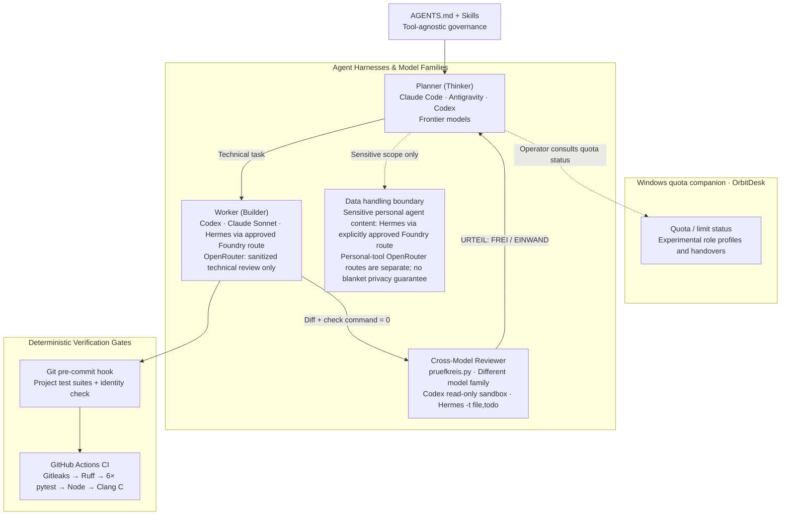

# Agentic AI Software Engineering

**I build AI agents — and I build software with AI agents.**

I build software together with AI coding agents — and I build the system around them that makes their work
verifiable: rules, gates, roles and handovers. I come from automation engineering (PLC programming, HMIs,
commissioning), and I bring its habits along: test against the real system, change one thing at a time, keep every
step reversible.

**My role: architect and orchestrator.** I am not a hand-coder, and I don't pretend to be one. I design the
architecture and the logic, cut the work into small steps that can be checked, and let AI agents write most of the
code. What I own is everything around it: I read and understand the code, I decide what counts as done, and I make
every claim checkable — by a test, a gate or a review from a second model. The
[Journey](JOURNEY.md) is the honest record of a steep learning curve over the last months.

This repository is my curated showcase. It shows **what I built**, **how I work with agents**, and **how I got
here**.

| Start here | What you find |
|---|---|
| [My Journey](JOURNEY.md) | From prompting to running several agents and models as one system — stage by stage, each with a project as evidence |
| [How I work](HOW-I-WORK.md) | The working method: verification gate, planner / reviewer / worker roles across harnesses, cross-model review, state in files |
| [Projects](#projects) | The projects that came out of it, from a PLC digital twin to a multi-agent control room (*Leitwarte*) |

---

## Multi-Agent Ecosystem & Control Room (*Leitwarte*)

Coming from industrial automation, I treat multi-agent software engineering like a **control room (*Leitwarte*)**:
multiple specialized harnesses and frontier/cloud models operate under one tool-agnostic rule set ([`AGENTS.md`](agent-setup/AGENTS.md)),
with verification through **[Cross-model review](projects/cross-model-review/)** and automated gates. **[OrbitDesk](projects/orbitdesk/)** is currently most useful as a Windows quota/limit display; its role profiles and handover functions are experimental, not a production coordination plane. See the [enterprise rollout guide](docs/enterprise-rollout.md) for current evidence and planned controls.

- **Agent harnesses:** **Claude Code** · **OpenAI Codex** (ChatGPT CLI & Desktop) · **Google Antigravity** · **Hermes** (sensitive agent-workflow content stays on the explicitly approved Foundry route)
- **Model & provider layer:** Frontier models across families (**Claude Opus/Sonnet**, **OpenAI GPT-6 Sol/Luna/Astra**, **Google Gemini**). **OpenRouter** is used by the personal-purpose speech tools with the user's credentials and by a separate sanitized technical-review route; these are distinct data flows, and OpenRouter carries no blanket privacy guarantee. Sensitive personal agent-workflow content stays with Hermes through an explicitly approved Foundry route. Azure / Foundry is an enterprise evaluation direction; its public source export remains subject to separate privacy review.

---

## Projects

| Project | What it is | Stack | Status |
|---|---|---|---|
| [OrbitDesk](projects/orbitdesk/) | Windows tray app for Claude Code and Codex quota/limit status; per-topic profiles and handover workflows are experimental | Python, tkinter, pystray, pytest | Quota display in daily use; profiles and handovers experimental |
| [Cross-model review](projects/cross-model-review/) | Review loop: a plan or result is checked by a fresh run of another model family; the verdict is a machine-readable line, the protocol is shown to me | Python, Codex CLI, Hermes | In daily use |
| [Personal AI agent](projects/personal-ai-agent/) | Personal assistant on Android: chat, long-term memory, tool calls, coding-agent routing | Python, FastAPI, web frontend, Termux | In daily use |
| [Private Tools](projects/tools/README.md) | Personal-purpose dictation, selected-text readback, and screenshot OCR/readback; current OpenRouter variants use user credentials, while the Azure / Foundry source export awaits privacy review | Windows, Python, PowerShell | Personal-purpose applications; Foundry variant in evaluation |
| [Sonos Music Drop](projects/sonos-music-drop/) | Local application concept for lowering music during speech; includes a clearly labeled browser simulation with sample data | Python concept, HTML, CSS, JavaScript | Simulation only; [download the repository](https://github.com/HeartledAgentEngineer/agentic-ai-software-engineering/archive/refs/heads/main.zip), extract it, and open `projects/sonos-music-drop/demo/index.html` |
| [Concertify](projects/concertify/) | Web app that builds concert playlists from live setlists; migration from prototype to a 5-layer architecture in progress (10 of 76 routes moved) | Python, Flask, SQLite, Server-Sent Events, Spotify / Ticketmaster APIs | Working prototype |
| [RAG knowledge base](projects/rag-knowledge-base/) | Semantic knowledge base with hybrid search (vector + full-text reciprocal rank fusion) | Python, FastAPI, PostgreSQL + pgvector, Mistral / Gemini | Working prototype |
| [Document automation](projects/document-automation/) | Data-driven CV generator: JSON → validated, escaped HTML → A4 PDF, plus PDF merging | Node.js, Puppeteer, pdf-lib, node:test | Stable local tool |

| [University foundations: mail-order company in C](projects/university-foundations/mail-order-c/) | My 2020 university lab code, unchanged — plus a 2026 review with compiler warnings and characterization tests | C (structs, pointers, linked lists, binary files), clang | Archive + review |

| [Agent setup](agent-setup/) | The skills, sub-agents and git hook behind the method | Markdown skills, Bash, Node.js | In daily use |

### Other experiments

| Project | What it is | Dependency / status |
|---|---|---|
| [Elevator digital twin](projects/elevator-digital-twin/) | Browser HMI experiment for TwinCAT logic | Requires the Node ADS bridge, WebSocket connection, and external browser assets; optional and network-dependent |
| [Squirrel game](projects/squirrel-game/) | Small canvas game from a rapid-prototyping exercise | Optional experiment |

```mermaid
graph LR
    subgraph OT["Where I come from"]
        U["University foundations (C)"]
        E["Elevator digital twin"]
    end
    subgraph Products["Own products"]
        C["Concertify"]
        R["RAG knowledge base"]
        D["Document automation"]
        S["Squirrel game"]
    end
    subgraph Daily["Tools I use every day"]
        T["typeFREE"]
        L["readFREE"]
        P["Personal AI agent"]
        SR["ShotReader"]
    end
    subgraph System["Agents as one system"]
        M["OrbitDesk · quota display"]
        X["Cross-model review"]
        A["Agent setup"]
    end
    OT --> Products --> Daily --> System
```

## Quality at a glance

Every push to `main`, pull request, and manual workflow dispatch runs [CI](.github/workflows/ci.yml): a full-history secret scan (Gitleaks), a lint gate (ruff, bug-class rules: syntax errors, undefined names), the test suites below, a syntax check of every JavaScript file, the Node test runner, and the C characterization tests.

| Project | Automated tests | Runs in CI | Known gap |
|---|---|---|---|
| OrbitDesk | pytest suite | yes (Windows) | tray/UI interactions use fakes in headless test runs; no fixed count asserted |
| typeFREE | 659 pytest tests (658 passed, 1 skipped on CI) | yes (Windows) | hotkeys and audio are mocked; real devices are tested by hand |
| readFREE | 88 pytest tests | yes (Windows) | clipboard, hotkey API, player and speech client are fakes; a manual smoke test covers real windows and audio, the real key press and voice are tested by hand |
| ShotReader | PowerShell self-test (`-Test`): speed rules, clipboard-format rule, image fingerprint, decision rules, 30-image memory, local OCR and speech | yes (Windows) | the OpenRouter speech call and the window are checked by hand |
| Concertify | 193 pytest tests (+ 2 skipped) | yes (Linux) | external APIs are stubbed; `app.py` still holds 66 of 76 routes and 6 `global` statements |
| Personal AI agent | 57 pytest tests | yes (Linux) | this is an excerpt; the full private suite is larger and not published |
| Cross-model review | 99 pytest tests | yes (Linux) | CLI agents are replaced by stand-ins; real review runs are logged in protocols |
| RAG knowledge base | 13 pytest tests (chunking + query path with fakes) | yes (Linux) | ingestion (`ingest.py`) and the real database are not tested; `test_embeddings.py` is a manual check against the live API |
| Document automation | 11 node:test tests (CV data model, HTML rendering, PDF merge error paths) | yes (Linux) | the browser PDF print step (Puppeteer) is checked by hand; `npm audit` reports 0 advisories (Puppeteer 25) |
| University foundations (C, 2020) | 12 checks in C against the unchanged 2020 code | yes (Windows, clang) | two of the checks pin known bugs on purpose; see the review |
| Elevator digital twin | — | JS syntax only (ADS bridge) | PLC logic needs the TwinCAT runtime and is checked by hand there, not in CI |
| Squirrel game | — | no | single HTML file with inline script, not covered by the JS check |

The gaps are listed on purpose: a green badge should not claim more than the pipeline checks.

## How the work is done

Every project here was built with AI coding agents (**Claude Code**, **OpenAI Codex**, **Google Antigravity**, and **Hermes** via **OpenRouter** / **Microsoft Foundry**). The short version of the method — the long one is in [How I work](HOW-I-WORK.md):

- **Done means verified.** A step is finished when the project's check command exits with 0, not when it looks
  plausible. A sub-agent's success message is not evidence; the diff is.
- **Rules are wishes, guards are rules.** What an agent *may* do is enforced by permission settings and a
  pre-commit hook, not by a sentence in a prompt.
- **Different roles, different models.** One model plans, a model from a different family reviews, cheaper
  models build — OrbitDesk displays quota status; its role profiles and handover workflow remain experimental. I watch the review protocols instead of carrying messages between agents.
- **State lives in files.** Plans, journals and handover files make it possible to stop, switch tools or switch
  agents in the middle of a task.
- **Code and docs in the same commit.** Documentation must not claim anything the code does not do.

## License

[MIT](LICENSE)
