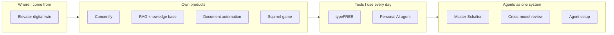

# Agentic AI Software Engineering

**I build AI agents — and I build software with AI agents.**

I build software together with AI coding agents — and I build the system around them that makes their work
verifiable: rules, gates, roles and handovers. I come from automation engineering (PLC programming, HMIs,
commissioning), and I bring its habits along: test against the real system, change one thing at a time, keep every
step reversible.

**My role: architect and orchestrator.** I am not a hand-coder, and I don't pretend to be one. I design the
architecture and the logic, cut the work into small steps that can be checked, and let AI agents write most of the
code. What I own is everything around it: I read and understand the code, I decide what counts as done, and I make
every claim checkable — by a test, a gate or a review from a second model. The
[Journey](JOURNEY.md) is the honest record of a steep learning curve over the last months.

This repository is my curated showcase. It shows **what I built**, **how I work with agents**, and **how I got
here**.

| Start here | What you find |
|---|---|
| [My Journey](JOURNEY.md) | From prompting to running several agents and models as one system — stage by stage, each with a project as evidence |
| [How I work](HOW-I-WORK.md) | The working method: verification gate, planner / reviewer / worker roles, cross-model review, state in files |
| [Projects](#projects) | The projects that came out of it, from a PLC digital twin to a multi-agent control app |

---

## Projects

| Project | What it is | Stack | Status |
|---|---|---|---|
| [Master-Schalter](projects/master-schalter/) | Windows tray app that shows the usage quotas of my coding agents, keeps the role of each project and hands work from one agent to another | Python, pystray, pytest | In daily use |
| [Cross-model review](projects/cross-model-review/) | Review loop: a plan or result is checked by a fresh run of another model; the verdict is a machine-readable line, the protocol is shown to me | Python, CLI agents | In daily use |
| [Personal AI agent](projects/personal-ai-agent/) | Personal assistant on Android: chat, long-term memory, tool calls | Python, FastAPI, web frontend, Termux | In daily use |
| [typeFREE](projects/typefree/) | System-wide dictation tool for Windows with selectable speech-to-text providers and text clean-up | Python, keyboard hooks, pytest | In daily use |
| [Concertify](projects/concertify/) | Web app that builds concert playlists from setlists | Python, Flask, SQLite, Server-Sent Events, Spotify / Ticketmaster APIs | Working prototype |
| [RAG knowledge base](projects/rag-knowledge-base/) | Semantic knowledge base with hybrid search | Python, FastAPI, PostgreSQL + pgvector, reciprocal rank fusion | Working prototype |
| [Document automation](projects/document-automation/) | Data-driven CV generator: JSON → validated, escaped HTML → A4 PDF, plus PDF merging | Node.js, Puppeteer, pdf-lib, node:test | Stable local tool |
| [Elevator digital twin](projects/elevator-digital-twin/) | Real TwinCAT 3 PLC logic driving a simulated elevator with a 3D HMI in the browser (hardware-in-the-loop) | Structured Text, Node.js ADS bridge, WebSockets, Three.js | Working prototype |
| [University foundations: mail-order company in C](projects/university-foundations/mail-order-c/) | My 2020 university lab code, unchanged — plus a 2026 review with compiler warnings and characterization tests | C (structs, pointers, linked lists, binary files), clang | Archive + review |
| [Squirrel game](projects/squirrel-game/) | Small canvas game, built as a rapid-prototyping exercise | HTML5 Canvas, vanilla JS | Finished |
| [Agent setup](agent-setup/) | The skills, sub-agents and git hook behind the method | Markdown skills, Bash, PowerShell | In daily use |

## Quality at a glance

Every push runs [CI](.github/workflows/ci.yml): a lint gate (ruff, bug-class rules: syntax errors, undefined
names), the test suites below, a syntax check of every JavaScript file and the Node test runner.

| Project | Automated tests | Runs in CI | Known gap |
|---|---|---|---|
| Master-Schalter | pytest suite | yes (Windows) | — |
| typeFREE | 656 pytest tests | yes (Windows) | hotkeys and audio are mocked; real devices are tested by hand |
| Concertify | 195 pytest tests | yes (Linux) | external APIs are stubbed |
| Personal AI agent | 53 pytest tests | yes (Linux) | this is an excerpt; the full private suite is larger and not published |
| Cross-model review | 96 pytest tests | yes (Linux) | CLI agents are replaced by stand-ins; real review runs are logged in protocols |
| RAG knowledge base | 5 pytest tests (chunking, query path with fakes) | yes (Linux) | ingestion (`ingest.py`) and the real database are not tested; `test_embeddings.py` is a manual check against the live API |
| Document automation | 10 node:test tests (CV data model, HTML rendering) | yes (Linux) | the PDF step (Puppeteer) is checked by hand |
| University foundations (C, 2020) | 12 checks in C against the unchanged 2020 code | yes (Windows, clang) | two of the checks pin known bugs on purpose; see the review |
| Elevator digital twin | — | JS syntax only (ADS bridge) | PLC logic needs the TwinCAT runtime and is checked by hand there, not in CI |
| Squirrel game | — | no | single HTML file with inline script, not covered by the JS check |

The gaps are listed on purpose: a green badge should not claim more than the pipeline checks.

## How the work is done

Every project here was built with AI coding agents (mainly Claude Code and Codex, plus an open-source agent for
private data). The short version of the method — the long one is in [How I work](HOW-I-WORK.md):

- **Done means verified.** A step is finished when the project's check command exits with 0, not when it looks
  plausible. A sub-agent's success message is not evidence; the diff is.
- **Rules are wishes, guards are rules.** What an agent *may* do is enforced by permission settings and a
  pre-commit hook, not by a sentence in a prompt.
- **Different roles, different models.** One model plans, a model from a different family reviews, cheaper
  models build. I watch the review protocols instead of carrying messages between agents.
- **State lives in files.** Plans, journals and handover files make it possible to stop, switch tools or switch
  agents in the middle of a task.
- **Code and docs in the same commit.** Documentation must not claim anything the code does not do.

## License

[MIT](LICENSE)
