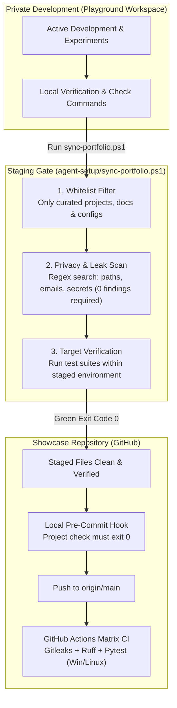

# Agent setup

The working parts behind [How I work](../HOW-I-WORK.md): skills, sub-agents, the commit gate and the rule sync.
They are written for Claude Code and kept tool-agnostic where possible. The texts are in German, as in daily use.

| Part | What it does | When it is used |
|---|---|---|
| [`AGENTS.md`](AGENTS.md) | the tool-agnostic master instruction file defining core rules: verification gates, code+docs, cross-model cascade, multi-agent collision protection, and privacy boundaries | read by every agent harness (Claude Code, Codex, Antigravity, Hermes) at session start |
| [`sync-portfolio.ps1`](sync-portfolio.ps1) | staged export & sync pipeline: moves whitelisted components from private playground to the showcase repo, runs privacy scan and triggers verification | whenever verified changes from the playground workspace are published to the showcase repository |
| [`skills/fehlersuche`](skills/fehlersuche/SKILL.md) | root-cause debugging: find the cause before proposing a fix | every error, failed test or unexpected behaviour, especially when the fix looks obvious |
| [`skills/grill-me`](skills/grill-me/SKILL.md) | the agent asks me questions until the goal is unambiguous, with a question catalogue and an alignment template | before planning, at design forks, when a wish could mean several things |
| [`skills/critic`](skills/critic/SKILL.md) | independent second opinion from a model of another family; `pruefe.mjs` runs it, `review.py` and `protokoll-schema.json` keep the verdict machine-readable | before a slice is committed, for security-related or concurrent code |
| [`agents/tester`](agents/tester.md) | runs the project's check command and reports only the result | testing and after refactoring, so test logs stay out of the main context |
| [`agents/rechercheur`](agents/rechercheur.md) | searches the workspace and returns only the finding | before a search would pull many files into the main context |
| [`githooks/pre-commit`](githooks/pre-commit) | no commit without a green check command for the touched project (`git config core.hooksPath agent-setup/githooks`); blocks author addresses that GitHub would assign to a foreign account | every commit once the hook path is configured |

## Staging & Synchronization Workflow

The transition from the private playground workspace to the public showcase repository follows a strictly verified staging pipeline:

## Why these exist

- **Skills instead of prose.** A rule in a long instruction file is easy to skip. A skill has a trigger
  description, a fixed procedure and, where possible, a script with an exit code.
- **Sub-agents for throw-away context.** Test output and search results are large and needed once. A sub-agent
  reads them and returns three lines.
- **A git hook is not an agent feature.** Once configured (`git config core.hooksPath agent-setup/githooks`), it runs for Claude Code, other agents and humans alike, so the gate does not depend on any agent remembering it. If a project's local `.venv` is not set up yet, the hook prints a warning and lets the commit pass so a fresh clone remains usable.

← [Back to overview](../README.md)
