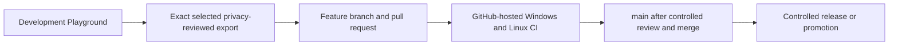

# Enterprise rollout guide

This guide separates the current public code and development checks from a proposed enterprise architecture. It is an evaluation guide, not a deployment claim.

**Status labels:** **Implemented** means the code exists in the named repository snapshot. **CI-configured** means a workflow is defined to run a check. **Planned** means the capability or process is a recommendation and is not implemented here.

## Current application and data boundaries

**Implemented — personal desktop use.** OrbitDesk is a Windows tray application for Claude Code and Codex quota/limit status. Its state is stored per user under `%USERPROFILE%/.master-schalter`. Claude quota refresh calls an authenticated usage endpoint; Codex status uses local session data and an app-server refresh. Local storage does not make the application offline.

**Implemented but experimental — profiles and handovers.** Per-topic profiles store routing preferences for a master, worker provider, and model. They do not launch worker sessions. The code also contains technical handover and acknowledgement flows protected by local topic locks. These features have not been established as an organization-wide orchestration service. The current application has no organization-level SSO, multi-tenant authorization, or central audit service.

**Privacy boundary.** The personal-purpose speech tools use separate, user-configured OpenRouter application routes; their speech or text is sent to the remote provider, and this is not a privacy guarantee. The agent-review workflow's OpenRouter route is different and accepts only sanitized technical input. Sensitive personal material stays with Hermes through an explicitly approved Foundry route. Foundry source exports remain behind a separate privacy review; this repository snapshot does not include a runnable Foundry variant. No general “privacy-first” guarantee is made for OpenRouter.

## Local use and enterprise reference architecture

**Current local setup:** install OrbitDesk on a user's Windows workstation, use that user's existing provider sign-ins, and keep configuration and state in that Windows profile. This is appropriate for individual evaluation. It is not a shared service, and profile fields are preferences rather than access-control roles.

**Planned enterprise design:** place an organization-controlled identity and policy layer in front of any shared agent services; map named groups to least-privilege project roles; keep each provider route explicit; and isolate each team's source and execution environment. A future Azure / Foundry variant would need its own reviewed source, deployment design, and privacy approval before it could be called available. SSO, managed identity, tenant isolation, and production Azure installation are not implemented by this portfolio snapshot.

## Configuration, credentials, and access

**Implemented:** OrbitDesk reads provider sign-in information from the user's existing local client environment. The Claude token is read at runtime and used for the usage request; the project does not provide a corporate credential vault. The personal-purpose OpenRouter tools require separately configured user credentials and contain no embedded keys; their app input is separate from the sanitized-only agent-review route.

**Planned for an enterprise pilot:** provision credentials through an organization-approved secret manager or managed identity; scope them by environment and provider; rotate them; keep secrets out of source, logs, screenshots, and handover packages; and record which identity may invoke each route. Define human approval for sensitive routes. Do not treat a local OrbitDesk profile as authentication or authorization.

## Pilot and employee rollout

**Planned:** begin with a small, named Windows pilot and non-sensitive test work. Document the supported provider routes, data classification, owner, support contact, and stop procedure before inviting users. Verify sign-in, quota display, failure messaging, and the manual workflow on each supported workstation. Keep automatic handover disabled until the organization has separately validated the target clients, ownership rules, and acknowledgement path. Expand by cohort only after the pilot's access, privacy, support, and rollback checks are signed off.

### Planned pilot for speech tools

typeFREE, readFREE, and ShotReader are **planned enterprise reference candidates**, not a currently available Foundry deployment. Their published personal-use routes send audio or text to the configured remote provider. Any enterprise source export remains quarantined until its separate privacy review is complete; this guide makes no claim that a reviewed Foundry build exists.

For a department pilot:

- Start with a small, named cohort and synthetic inputs only. Define representative cases for dictation, selected-text readback, and screenshot OCR/readback.
- Document each case's audio/text flow: input, local processing, provider route, output, storage, and retention. Record the accountable department owner and operations contact.
- Set a cohort budget and a stop-before-spend gate. Estimate the next run's cost before enabling provider calls; stop new calls when the approved cap is reached.
- Keep a manual fallback and a named person who can disable the route. Do not use real employee, customer, or regulated content in this proposed pilot until a separate data approval exists.

**Suggested acceptance criteria — proposals, not measured results:** every workflow passes its synthetic cases; the data-flow record and owner are approved; telemetry contains no audio, transcript, screenshot, or prompt content; latency, errors, and provider 429 responses are visible; the spend cap stops further calls; and the route-disable and rollback procedures are rehearsed. Set any numeric latency and error thresholds before the pilot, then report measured values separately.

## CI, releases, and portfolio promotion

**Public CI-configured:** the public repository's [CI workflow](../.github/workflows/ci.yml) runs Gitleaks, Ruff, an OrbitDesk Windows pytest job, and the other listed project checks. This workflow verifies source; it does not deploy an enterprise service.

**Planned promotion flow:**

GitHub automatically runs the configured checks for the selected commit. Review and merge to `main`, plus any later release or promotion, remain controlled steps. The public CI tests source; it does not deploy an enterprise application.

**Separate development Playground:** tag workflows exist for Windows executable builds and draft releases for typeFREE and OrbitDesk, gated by their configured tests. The Playground also has a curated exporter; its artificial-fixture tests have been run separately. These development tools are distinct from the public repository's `ci.yml`. The evidence reviewed for this candidate does not establish automatic, version-bound promotion from an approved Playground milestone to a sanitized public pull request. Promotion remains a controlled preparation and review step; each public change must pass the public CI for its exact commit.

## Monitoring, cost, scale, and rollback

**Implemented:** OrbitDesk presents local quota/limit status and stale or unknown measurements. **Not implemented:** central service health, organization-wide alerts, cost allocation, audit aggregation, autoscaling, or a fleet-management console.

**Planned operational telemetry:** monitor latency, error rate, provider 429 responses, and cost by approved environment or cost label. Keep audio, transcripts, screenshots, prompts, and generated text out of telemetry; retain only approved operational metadata. Assign an owner and budget before increasing use.

**Planned scale controls:** load-test with synthetic traffic; set admission limits per environment and tenant; apply backpressure and bounded retries; and isolate configuration, credentials, storage, and workloads by environment and tenant. These controls are recommendations, not implemented portfolio features.

**Planned release and rollback controls:** use versioned configuration and releases, keep a known-good version available, and provide a kill switch that stops new provider calls. During a pilot, disable the affected route, then remove the cohort's access or restore its last known-good configuration. Rehearse the rollback before expanding. The public `ci.yml` is a test workflow, not a deployment or rollback system.

## Evidence and open work

- OrbitDesk package metadata and setup: [`projects/orbitdesk/pyproject.toml`](../projects/orbitdesk/pyproject.toml) and [project guide](../projects/orbitdesk/README.md).
- Public verification: [`.github/workflows/ci.yml`](../.github/workflows/ci.yml).
- Speech tools and their personal-use routes: [Private Tools](../tools/README.md). Foundry source is not linked because it is not included in the reviewed public snapshot.
- Open work: privacy review for any Foundry source export; an organization-specific identity and deployment design; operational monitoring and cost controls; and independently verified promotion/rollback steps.
