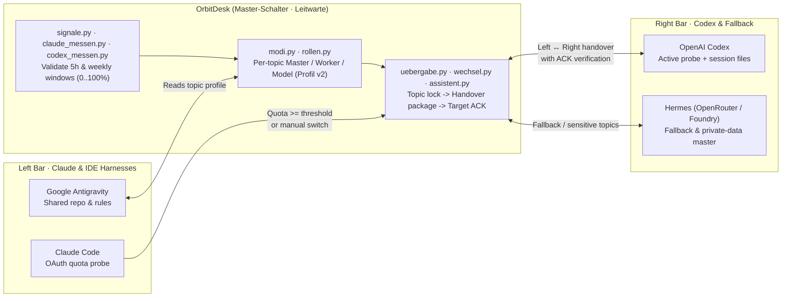

# OrbitDesk (Master-Schalter)

A Windows tray and control-room app (*Leitwarte*) for orchestrating several AI coding agents as one system. Coming from industrial automation (PLC/SCADA control rooms), I built OrbitDesk (internal package name `master_schalter`, German for "master switch") as the central control desk that tracks live usage quotas, manages per-project agent roles (`planner` / `reviewer` / `worker` and model selection across **Claude Code**, **OpenAI Codex**, **Google Antigravity**, and **Hermes**), enforces topic locks, and hands a project from one agent harness to another with a verified technical handover package.

**Stack:** Python 3.12 · standard library for the core · `tkinter` (control window) · `pystray` + Pillow (tray) · pytest (`2,043` tests)

## What it does

- **Live quota bars in the taskbar:** Claude on the left, Codex on the right. The fill shows the 5-hour usage: normal
  colour up to 79 %, yellow from 80 %, red from a configurable threshold (default 97 %).
- **Control room for roles per topic:** for each project it stores which agent harness is master/planner, which agent executes (`worker`), and with which model (`masterwechsel profil <topic> --json`). Agents read this profile before starting any worker run.
- **Handover assistant:** "topic X: old chat → new chat". It writes a handover package (technical metadata only),
  delivers it to the target chat, waits for an acknowledgement and logs every decision.
- **Automatic switch (off by default):** when Claude reaches its limit on an enabled topic pair, the topic is handed over to Codex (`v0.3.0+`, at most one switch per quota window).
- **Multi-agent orchestration roadmap & OrbitView (Mobile MCP Companion):** evolving from quota switching and role profiles into a full SCADA-like operator console (*Leitwarte*):
  - **MCP Integration (Model Context Protocol):** Exposing OrbitDesk's live quotas, topic ownership locks, and handover queues as standard MCP resources and tools, enabling agents across Claude Code, Antigravity, and Codex to query system state deterministically.
  - **OrbitView (Mobile Frontend):** A responsive, mobile-first companion view for smartphones that gives me full visibility into the workstation's agent fleet on the go — visual quota bars, active project locks, and handover status right from the phone browser without needing Remote Desktop or Termux terminal sessions.



## Where the numbers come from

- **Codex** is measured both actively (`codex_messen.py` via `masterwechsel codex-messen` / tray timer every 5 minutes, writing `codex-kontingent.json`) and from Codex session files (`signale.py`). Both the 5-hour and weekly windows must contain valid numbers from 0 to 100 % with a valid reset timestamp; anything else counts as "unknown" and never triggers a handover.
- **Claude Code** is measured through its OAuth usage endpoint (`claude_messen.py`). The access token is read at runtime, used only in
  memory and never stored or logged. This endpoint is unofficial and has changed before; the code handles the
  known variants and otherwise keeps the last value with its timestamp.

## Design decisions

- **Fail closed.** Unknown values, stale measurements (> 15 min), missing ownership markers or a failed acknowledgement stop the automatic path
  instead of guessing.
- **Locks per topic** so two agents never take over the same project at the same time.
- **Core without dependencies:** state, decisions and CLI use only the standard library; only the UI needs extra
  packages.
- **Data folder under `%USERPROFILE%`, not `%LOCALAPPDATA%`:** the Claude and Codex apps are MSIX packages whose
  child processes get a redirected `AppData\Local`, so each launcher would otherwise read a different state.

## Structure

```
src/master_schalter/
  signale.py, claude_messen.py, codex_messen.py   read, probe and validate the quotas
  modi.py, rollen.py                              roles, worker provider and model per topic (Profil v2)
  uebergabe.py, wechsel.py                        handover package, switch under locks
  assistent*.py, postfach.py                      handover assistant and mailbox
  automatik.py, codex_senden.py                   automatic path
  fenster*.py, leiste.py, cli.py                  window, tray, command line
tests/                                            2,043 pytest tests, synthetic files only
```

## Run it

Windows.

```powershell
python -m venv .venv
.\.venv\Scripts\python.exe -m pip install -e ".[leiste,dev]"
.\.venv\Scripts\pythonw.exe -m master_schalter.leiste    # tray icon & OrbitDesk window
.\.venv\Scripts\masterwechsel.exe status                 # quotas in the console
.\.venv\Scripts\masterwechsel.exe profil <topic> --json  # role & worker model profile
.\.venv\Scripts\python.exe -m pytest -q                  # 2,043 passed, 1 skipped; also run in CI
```

Version 0.5.1. The code and comments are in German; that is the language I work in.

← [Back to overview](../../README.md)
