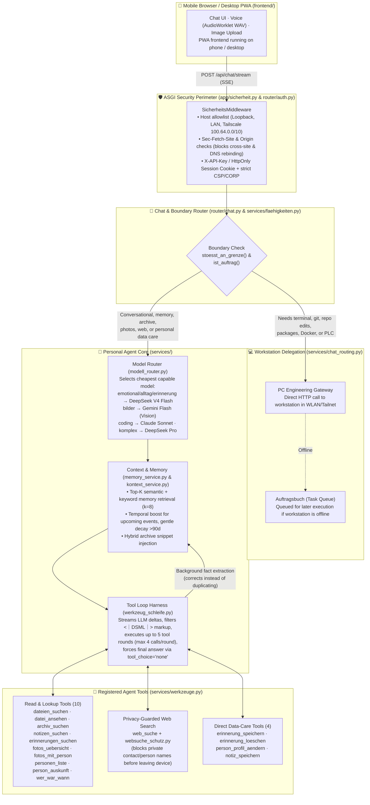

# Personal AI Agent

My personal assistant and the largest software system in this portfolio. It runs **phone-first**: a FastAPI backend inside **Termux on Android** (`127.0.0.1:8080` / LAN / Tailscale), an installable Progressive Web App (PWA) in the mobile browser, language and vision models routed through **OpenRouter**, and a deterministic boundary router that delegates engineering and system tasks to the workstation whenever a request requires shell execution, file changes, or git workflows.

> **Why this folder is an architectural excerpt:**
> Everything that touches personal data stays strictly in my private workspace: photo and face-recognition pipelines, WhatsApp/chat archive imports, pCloud storage clients, daily well-being logs, and live handovers. Names in examples and unit tests are fictional.
> This repository contains the **complete architectural core** (chat router, multi-round tool harness, workstation delegation router, task-based model router, correction-preserving memory service, privacy guards, ASGI security middleware, and PWA frontend) along with **53 offline unit tests** that run in CI without private data or API keys.

**Stack:** Python 3.12 · FastAPI · Raw ASGI Security Middleware · Server-Sent Events (SSE) · OpenRouter (DeepSeek V4 Flash/Pro, Gemini Flash, Claude Sonnet, MAI-Transcribe-2, Whisper Large v3) · SQLite (FTS5 + vectors) · Vanilla JS PWA · Termux & tmux · pytest

---

## Sub-Directory Documentation

To make the codebase easy to navigate without guessing what individual scripts or methods do, detailed guides are provided at each layer:

- **[`backend/README.md`](backend/README.md)** — Module-by-module and function-by-function reference for the FastAPI application (`app/main.py`, `app/sicherheit.py`), HTTP routers (`app/router/`), core services (`app/services/`), JSON vector store (`app/db/`), and test suite (`tests/`).
- **[`frontend/README.md`](frontend/README.md)** — Architecture of the mobile-first Progressive Web App (`index.html`, `app.js`, `style.css`, `sw.js`): dual-chat mode (`conv_main` vs. `conv_code`), live SSE streaming with adjustable reading speed, auto-collapsing thought bubbles (`🧠`) with zero-jump scroll compensation, AudioWorklet voice dictation, and interactive OpenRouter model filter sheet.

---

## System Architecture & Request Lifecycle

Every message sent from the phone or desktop browser passes through four deterministic stages: **ASGI Origin/Host Verification**, **Capability Boundary Check (Hermes vs. Self)**, **Task-Based Model Routing**, and the **Multi-Round Agent Tool Loop**:



---

## Core Engineering Mechanisms (Included in This Repo)

### 1. Deterministic Capability Boundaries & Workstation Delegation (`faehigkeiten.py`, `chat_routing.py`)
Instead of letting an LLM hallucinate that it executed a shell command or promising a tool it does not have, the backend evaluates a deterministic capability manifest (`FAEHIGKEITEN`) **before** calling the chat model:
- **What the agent handles itself (`kann`)**: Dialog, long-term memory (`gedaechtnis`), direct personal data/contact updates (`daten_aendern`), web search (`websuche`), chat archive lookup (`archiv`), document/image analysis (`dokument_text`), face catalog updates (`gesichter_merken`), and voice I/O (`tts_stt`).
- **What crosses the boundary (`kann_nicht` → Workstation)**: Terminal commands (`terminal`), repository file writes (`dateien_schreiben`), package installations (`tool_install`), `git` operations (`commit`/`push`/`pull`/`merge`), and system/Docker/PLC tasks (`system_zugriff`).
- **Read vs. Write Disambiguation**: Pure read requests (`"lies meine Datei"`, `"was steht in"`, `"zeig mir"`) and personal data care (`"ändere den Geburtstag im Telefonbuch"`) are explicitly exempted in `stoesst_an_grenze()` so the agent answers them directly via its own tools instead of falsely delegating to a coding agent.

#### Workstation Delegation & Architecture Clean-Up
When an engineering task is detected, `chat_routing.py` dispatches it to the desktop workstation (`Track A` via HTTP) where full test suites, compilers, and isolated git worktrees live. If the workstation is offline, the task is safely queued in the `Auftragsbuch` (`Track B`) with an honest status explanation rather than pretending background work is running.

> **Note on the retired mobile Termux prototype:**
> In an earlier development phase, an experimental branch attempted to spawn a local coding agent directly inside Termux on the phone (`Track C` via `tmux`). While I used Hermes directly from the Termux terminal for manual experimentation, running an autonomous coding daemon *through the agent web app* never worked reliably in practice (Android aggressively terminates background processes, battery drains rapidly, and phone hardware lacks the required build environment).
> 
> That prototype has been retired from active use. The Personal AI Agent focuses entirely on its core role as an intelligent personal companion (**Live Voice Mode**, memory, personal tools), while engineering tasks are orchestrated from the workstation and will be monitored via the upcoming **OrbitDesk MCP integration**.

### 2. Multi-Round Tool Loop Harness (`werkzeug_schleife.py`, `werkzeuge.py`)
`werkzeug_schleife.laufe()` implements a dependency-injected OpenAI-format streaming tool loop:
- **Streaming + Tool Collection**: Streams text tokens (`{"delta": ...}`) immediately to the UI while reassembling fragmented `tool_calls` and provider `reasoning_details` across chunks.
- **DSML Markup Shield (`_DsmlFilter`)**: Some models occasionally leak raw tool-call syntax (`<｜DSML｜` or `<|DSML|`) as plain text. `_DsmlFilter` buffers suspicious prefixes at chunk boundaries and strips leaked markup before it can reach the user.
- **Concrete Live Status Lines**: When the model invokes a tool, `werkzeuge.status_text(name, args)` generates a human-readable status with the actual arguments (e.g., `🔧 sucht Fotos mit einer Person (Person „Lena“) …` instead of a generic spinner).
- **Bounded Execution & Invariant Check**: Caps execution at `MAX_RUNDEN = 5` (up to `MAX_AUFRUFE_JE_RUNDE = 4` tool calls and `MAX_BILDER_JE_RUNDE = 3` images per round), then forces a final synthesis call with `tool_choice="none"`. `pruefe_register()` enforces in CI that every schema offered to the model maps 1:1 to a callable handler in `REGISTER`.

### 3. Long-Term Memory That Corrects Instead of Deleting (`memory_service.py`, `db/chroma_client.py`)
- **Duplicate vs. Correction Detection**: Naive similarity thresholds (>0.90) reject fact corrections because `"Mein Hund heißt Rex"` and `"Mein Hund heißt Max"` have >0.93 string similarity. `memory_service.py` compares the non-filler tokens (`FUELLWOERTER`): if only stop words differ, it skips the duplicate; if a substantive token (name, number, date) changed, it updates the active fact and appends the old version to the entry's `history` list. Nothing is ever overwritten destructively.
- **Top-K Relevance & Temporal Ranking**: Instead of dumping all memories into every prompt, `retrieve_relevant_memories()` scores entries by cosine similarity (OpenRouter `text-embedding-3-small`) or keyword overlap, adds a temporal bonus for upcoming events (`TERMIN_BONUS_NAH = +0.30` within 14 days, `+0.15` within 60 days), and applies a gentle age discount after 90 days (`ALTER_FREI_TAGE = 90`, capped at `-0.10`) so old memories fade in priority without disappearing.

### 4. Privacy-First Web Search & PII Shield (`websuche_schutz.py`, `llm_service.py`)
- **Name Blacklist Before Network Egress (`websuche_schutz.py`)**: General topics, places, and public figures can be searched online, but **never people from my private life**. `bestand_bauen()` indexes known first/last names from the photo catalog and full multi-word names from the contact list (normalized for German umlauts `ä→ae`, `ß→ss`, and genitive `-s`). If `enthaelt_namen()` matches a query — unless explicitly authorized for a public namesake in the user's prompt via `freigaben()` — `web_suche.py` blocks the request before it leaves the phone.
- **Pre-Flight PII Masking in Voice Polishing**: Dictated audio is transcribed via a 3-stage OpenRouter fallback chain (`microsoft/mai-transcribe-2` at 0.3% German WER → `mai-transcribe-1.5` → `openai/whisper-large-v3`) and polished by `gemini-2.5-flash` with `PIIShield` token substitution (`[PERSON_01]`, `[LOC_01]`).

### 5. Security Found by Testing (`sicherheit.py`, `router/auth.py`)
An automated security test revealed that `allow_origins=["*"]` combined with an unguarded config endpoint allowed any website opened in the phone's browser to read `http://127.0.0.1:8080` and extract the API key. `SicherheitsMiddleware` fixes this at the raw ASGI layer (without buffering SSE streams):
- Rejects unknown `Host` headers (`HTTP 400`) to block DNS-rebinding attacks; allows only loopback (`127.0.0.1`, `::1`, `localhost`), RFC-1918 LAN IPs, Tailscale (`100.64.0.0/10`), and configured `ERLAUBTE_HOSTS`.
- Rejects cross-origin browser requests (`Sec-Fetch-Site: cross-site` / `same-site` or foreign `Origin` → `HTTP 403`).
- Injects the API key into `<meta name="agent-schluessel">` **only** when serving `index.html` to a loopback client (`client_ist_loopback()`), and enforces `X-API-Key` or `HttpOnly` session cookies on `/api/*`.

---

## Full Daily-Driver Capabilities (Private Modules Overview)

In daily production on my phone and PC, `app/main.py` mounts 26 routers. Alongside the core modules included in this repo, the full system provides:

| Capability | Router / Service in Full System | How It Works |
|---|---|---|
| **Hybrid Knowledge Archive** | `archiv.py`, `archiv_wissen.py`, `archiv_suche.py` | Read-only SQLite index (`archiv_index.db`, `mode=ro`) over 1,100+ conversations / 40,600+ messages from ChatGPT, Claude, Gemini, WhatsApp, Calendar, and Notes. Combines FTS5 full-text search with vector embeddings and returns exact original message pointers with context windows. |
| **Photo Memory & Face Clustering** | `gesichter.py`, `gruppen.py`, `fotos.py` | Local face detection (`YuNet`) and 128-d embedding (`SFace` with 5-point landmark alignment) grouped via complete-linkage clustering. Includes a mobile **Group Naming Quiz** (`gruppen_quiz.js`) and bounding-box editor that syncs birthdays and phone numbers with the contact book. |
| **Interactive Storytelling Slideshow** | `erzaehlen.py`, `erzaehl_service.py`, `erzaehlen.js` | Full-screen event slideshow (`📖`) where I record or type personal memories per photo. Synthesizes Gemini Vision scene descriptions, event metadata, and family relationships into natural first-person or narrator stories (strictly separated from raw notes in append-only `geschichten.jsonl`) with Web Audio TTS playback. |
| **Daily Well-Being Log (Alltagsprotokoll)** | `tageslauf.py`, `alltag.py` | Tracks sleep windows (deduplicating overlapping watch sessions), mood, tension, and daily activities with a 7-day correlation view in the UI and chat tool access. |
| **Full-Duplex Voice & Phone Agent** | `voice_stream.py`, `sprachbefehl_service.py` | WebSocket audio streaming (`/api/voice/stream/{session_id}`) with voice activity detection (VAD), <150 ms barge-in interruption, and natural German voice navigation commands (`"5 Seiten weiter"`, `"zeig mir das erste Bild"`). |
| **Cable-Free Mobile Self-Test** | `selbsttest.py` (included in `router/selbsttest.py`) | `GET /api/selbsttest` inspects git commit, SQLite archive health, `hermes_inbox_daemon.py` process state, recent log lines (truncated to 200 chars), memory count, and masked pCloud quota so system health can be checked on the phone without ADB. |

---

## Run the Included Unit Tests

All 53 unit tests included in this portfolio excerpt run offline (using dependency injection and temporary directories, with zero network calls):

```powershell
cd backend
pip install -r requirements.txt -r requirements-dev.txt
pytest -q tests    # 53 passed
```

The source code, identifiers, and docstrings are written in German, matching my daily engineering environment.

← [Back to portfolio overview](../../README.md)
