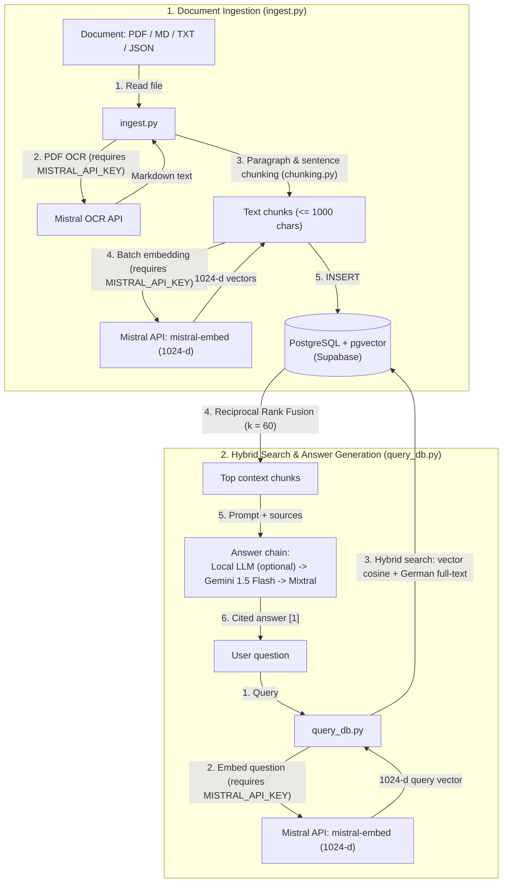

# RAG knowledge base

A local Python RAG (Retrieval-Augmented Generation) pipeline: documents are split into paragraph-aware chunks, embedded via the Mistral API (`mistral-embed`, 1024 dimensions), and stored in PostgreSQL with `pgvector`. Questions are answered from the top-ranked chunks using hybrid search (vector similarity + full-text Reciprocal Rank Fusion) with inline source citations.

**Stack:** Python · FastAPI · PostgreSQL + `pgvector` (Supabase) · Mistral API (`mistral-embed` 1024-d & Mistral OCR) · Answer chain: local LLM (optional) → Gemini (`gemini-1.5-flash`) → Mistral (`open-mixtral-8x22b`) · `pywebview` desktop shell

## Origin & how it evolved

1. **Practice project based on an Everlast AI RAG tutorial (n8n prototype):** I originally started this project as a structured learning exercise following an **Everlast AI** video/curriculum on RAG architectures, which wired the pipeline together in **n8n Cloud**.
2. **Rebuilt as a standalone Python pipeline (no n8n subscription):** Because I did not want recurring n8n cloud costs or a black-box no-code server in the middle, I rebuilt the entire workflow in Python (`init_db.py`, `ingest.py`, `chunking.py`, `query_db.py`, `main.py`).
3. **Important boundary — cloud APIs are still required for embeddings & OCR:** Removing n8n eliminated the workflow-platform fee, **not** the model APIs. Even if you enable a local LLM (`USE_LOCAL_LLM=true` via Ollama) for the final answer generation step, **ingestion and querying always require a `MISTRAL_API_KEY`** because both PDF OCR and the 1024-dimensional query/document embeddings are computed via Mistral's `mistral-embed` API (there is no local embedding model in this pipeline).



## How it works

- `init_db.py` creates the `documents` vector table, a German full-text index, and the SQL function `hybrid_search`.
- `ingest.py` converts PDFs via Mistral OCR, splits documents into chunks (`chunking.py`), embeds them via `mistral-embed`, and stores them in PostgreSQL.
- `query_db.py` embeds the user question via `mistral-embed`, runs `hybrid_search`, and generates the cited answer.
- `main.py` / `desktop_app.py` provide the local FastAPI server (`127.0.0.1:8000`) and a small desktop window around `static/index.html`.

**Hybrid search with reciprocal rank fusion.** `hybrid_search` ranks every chunk twice — by vector similarity (`pgvector` cosine distance) and by German full-text rank (`ts_rank_cd`) — and combines both rankings with `1 / (k + rank)`, `k = 60`. A chunk that scores well in both lists wins, even if it is first in neither.

**Answer chain.** For text generation (after retrieval), `generate_answer` tries a local LLM first (only if `USE_LOCAL_LLM=true`), then Gemini (`GEMINI_API_KEY`), then Mistral (`MISTRAL_API_KEY`). Only if all configured answer models fail does it raise an error.

**Chunking under test.** `chunking.py` holds the paragraph chunker without any API or database import, so `tests/test_chunking.py` runs in CI using mocked inputs: paragraph boundaries, sentence ends instead of commas for oversized paragraphs, and page markers. Its first run found a real bug — a chunk was tagged with the page of the *next* paragraph when a new page began there, so source citations pointed one page too far. Now each chunk keeps the page it starts on.

**Query path under test.** `tests/test_query_db.py` tests `query_db.py` against fakes (mocks) for the network and the database: it verifies that `query_db.py` aborts before any network call when `MISTRAL_API_KEY` or `SUPABASE_CONNECTION_STRING` is missing, builds the `hybrid_search` call and result rows, labels each context chunk with its source (`course -> module` before `file_name`), and walks the fallback chain `local model -> Gemini -> Mistral`. Its first run found a real bug: the Mistral embedding call was the only network call without a timeout, so a hanging API froze the whole query. It now has a 30 s timeout like the others.

`test_embeddings.py` is a separate, manual plausibility check against the live Mistral API (requires `MISTRAL_API_KEY`): a related pair (`Hund`/`Katze`, cosine similarity `0.7174`) comes out closer than an unrelated pair (`Hund`/`Auto`, `0.6589`).

**Local-only scope.** `main.py` binds to `127.0.0.1:8000`, validates `Host` and local `Origin`/`Referer` headers on state-changing requests (with optional `RAG_API_TOKEN`), refuses to overwrite existing files in `/sync` unless `overwrite=true` is passed explicitly, and checks that uploaded or opened files stay inside `RAG_DOCUMENTS_DIR` (default `P:\RAG_Documents`).

## Run the pipeline (requires API keys & database)

To actually run `init_db.py`, `ingest.py`, `query_db.py`, or `main.py`, you **must** provide a `.env` file with your database connection and API keys:

```powershell
pip install -r requirements.txt
# Create .env with:
#   SUPABASE_CONNECTION_STRING=postgresql://...   (required: PostgreSQL + pgvector)
#   MISTRAL_API_KEY=...                           (required: mistral-embed 1024-d embeddings, PDF OCR & fallback LLM)
#   GEMINI_API_KEY=...                            (primary answer LLM: gemini-1.5-flash)
python init_db.py
python ingest.py <file>
python main.py
```

## Run the unit tests (mocked, no live API keys required)

Only the unit test suite (`tests/test_chunking.py` and `tests/test_query_db.py`) runs without API keys or a database because all HTTP and `psycopg2` calls are replaced by test doubles:

```powershell
python -m pytest -q tests    # 13 unit tests using mocks for Mistral & PostgreSQL
```

← [Back to overview](../../README.md)
