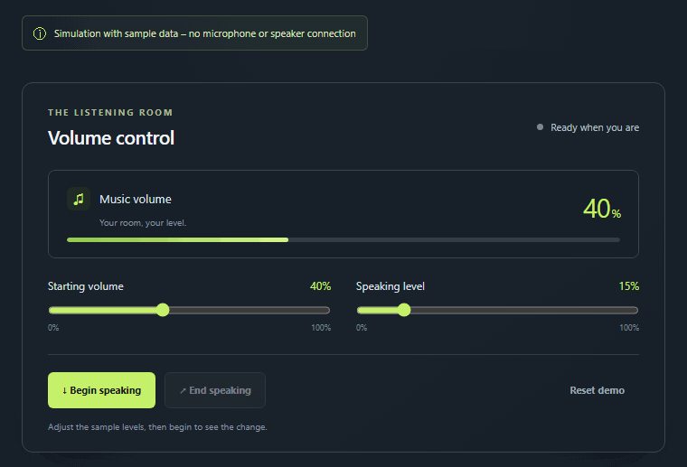

# Sonos Music Drop



**What you see:** the browser simulation below with sample data — the starting volume is raised to 70 % with the
keyboard, *Begin speaking* lowers the music to the 15 % speaking level, *End speaking* restores exactly 70 %. No
microphone, speaker or network is involved; the frames were recorded in a headless browser by
[`scripts/demos/record-browser-demos.cjs`](../../scripts/demos/record-browser-demos.cjs).

Sonos Music Drop is a local Python application concept for lowering music while speech is present and restoring the previous listening level afterward. The application source is not included here. A separate privacy review is required before any real application source can be exported.

## Browser simulation

The [`demo`](demo/index.html) is an independent, deterministic browser simulation using sample numbers. It shows the volume behavior and does not connect to a microphone, Sonos speaker, network service, or AI model. It needs no installation: download the repository from [GitHub](https://github.com/HeartledAgentEngineer/agentic-ai-software-engineering/archive/refs/heads/main.zip), extract it, then open `projects/sonos-music-drop/demo/index.html` in a browser.

## What it demonstrates

- Choose a starting music volume and a speaking level from 0 to 100.
- Begin speaking to lower the sample volume to the lower of those levels.
- End speaking to restore the exact starting value.
- Reset to the sample defaults of 40% volume and 15% speaking level.

The levels are illustrative state only. The simulation does not detect speech, play or control audio, connect to speakers, or provide an AI response. It does not demonstrate the behavior or reliability of the separate Python application.

## Local checks

From the repository root, run `node --test projects/sonos-music-drop/demo/ducker.test.js` and `node scripts/verify-showcase.mjs`. The optional `projects/sonos-music-drop/demo/browser-check.cjs` requires Playwright and a locally installed Microsoft Edge browser; set `SONOS_QA_DIR` to choose where its screenshots are written.

The demo GIF is not drawn by hand. To record it again (Playwright and Microsoft Edge, as above):

```bash
npm install --prefix "$TMP/demo-deps" --ignore-scripts playwright@1.62.1 gifenc@1.0.3 pngjs@7.0.0
NODE_PATH="$TMP/demo-deps/node_modules" node scripts/demos/record-browser-demos.cjs sonos
```

The script asserts every state before it keeps a frame (40 % → 70 %, speaking level 15 %, restored 70 %) and blocks
all network requests. Two runs usually produce the same bytes; when they do not, only a few anti-aliased pixels of
the native slider differ by one colour step.

[Back to overview](../../README.md)
