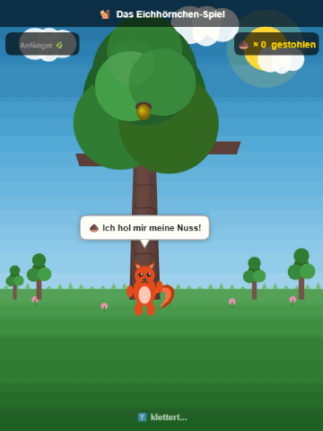

# Squirrel game



**What you see:** the real game in a headless browser — the squirrel climbs to the crown, a tap steals the nut (the
counter goes from 0 to 1), and after a short search a new nut appears. The game text is German. Shaking the branch
and the later levels are not part of the recording.

A small HTML5 canvas game with a reversed idea: you don't collect nuts, you steal them from a squirrel or shake
the branch until it falls. Built spontaneously for a party and sent to the guests' phones as a single file.

**Stack:** HTML5 Canvas · vanilla JavaScript (ES5) · no build, no assets

## How it works

Everything lives in one `index.html` (about 560 lines of JavaScript):

- **Game loop** with `requestAnimationFrame` → `update()` + `draw()`.
- **State machine** instead of scattered flags: `climb → crown → fall → dead → climb`.
- **Levels as data:** an array maps nut thresholds to skins (normal, cool, Frodo, Shrek). One game logic carries
  all four worlds.
- **Procedural graphics:** tree, sky, characters and particles are drawn at runtime. There is no image file.
- **Fixed logical resolution** (480×640), scaled by CSS; touch coordinates are mapped back, so hit tests don't
  depend on the device.

## Decisions

- **One file, zero dependencies.** On a party you don't control the devices; a single HTML file opens anywhere.
- **Own Bézier ovals instead of `ctx.ellipse`**, because older mobile WebViews didn't support it reliably.
- **ES5 syntax** for old Android browsers.

## Run it

Open `index.html` in any browser, desktop or phone. Tap the nut to steal it, tap a branch to shake it.

## Check it yourself

The game has no unit tests. The recording script is the automated check: it seeds `Math.random`, steps
`requestAnimationFrame` frame by frame, and asserts the game state before it writes the GIF (climb → crown, nut
counter 0 → 1, a new nut appears). The same input gives a byte-identical GIF. From the repository root, with
Playwright and Microsoft Edge:

```bash
npm install --prefix "$TMP/demo-deps" --ignore-scripts playwright@1.62.1 gifenc@1.0.3 pngjs@7.0.0
NODE_PATH="$TMP/demo-deps/node_modules" node scripts/demos/record-browser-demos.cjs squirrel
```

← [Back to overview](../../README.md)
