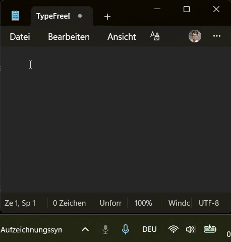

# Private Tools

These Windows applications support personal speech input and reading workflows. “Private” describes their personal purpose, not repository visibility: their source is available in this public repository. Running an application on Windows does not mean it works offline. The personal-use OpenRouter variants send speech or text to a remote provider when those features are used.

## Speech input and reading

### typeFREE — dictation and text clean-up

Hold the configured hotkey to record from the microphone into memory. Releasing the key sends the recording through the configured speech-to-text provider chain, then sends the transcript through the configured text clean-up step. The resulting text is placed on the clipboard for the active application. The published personal-use configuration uses OpenRouter; it requires the user's own externally configured API credential.

The GIF is a workflow preview, not a live browser demo. The application source remains at [projects/typefree](../typefree/).

### readFREE — read selected text aloud

Select text in a Windows application and press the configured hotkey. readFREE obtains the selected text, requests speech from its OpenRouter text-to-speech provider, and plays the returned audio through Windows audio playback. It needs the user's own configured provider credentials and a network connection for speech generation. The small speech-client module is outside this repository. There is no browser demo; see the [readFREE project](../readfree/).

### ShotReader — OCR and spoken reading

Copy a screenshot or text into the Windows app. For an image, Windows OCR extracts the text on the device; the user can review it before it is split into chunks and sent to OpenRouter text-to-speech. The returned audio is played locally. OCR on the device does not make the whole workflow offline: speech generation still uses the configured remote service. Its test mode does not call OpenRouter. See the [ShotReader project](../shotreader/).

## Personal and enterprise variants

| Tool | Personal-purpose application route | Azure / Foundry enterprise evaluation route |
|---|---|---|
| typeFREE | User-configured OpenRouter speech-to-text and text clean-up; requires the user's own credential | Source export is pending separate privacy review; no runnable Foundry variant is published here |
| readFREE | User-configured OpenRouter text-to-speech; speech client is external to this repository | Source export is pending separate privacy review; no runnable Foundry variant is published here |
| ShotReader | Windows OCR on the device, then user-configured OpenRouter text-to-speech | Source export is pending separate privacy review; no runnable Foundry variant is published here |

The OpenRouter route is the user's own credentialed cloud service for these personal-purpose applications. Audio or text leaves the device when the route is used; public source visibility and local handling do not provide a privacy guarantee. The separate OpenRouter agent-review route in this portfolio accepts only sanitized technical input. Sensitive personal material stays with Hermes through an explicitly approved Foundry route; do not submit it through these OpenRouter application variants.

The Azure / Foundry column describes an intended evaluation direction, not a downloadable product variant. The Foundry source export is pending its separate privacy review; there is no public runnable Foundry demo or production deployment claim.

Source locations are unchanged: `projects/typefree/`, `projects/readfree/`, and `projects/shotreader/`. The portfolio lists source links and the typeFREE GIF as a preview; it does not present GitHub's code view as a playable demo.
