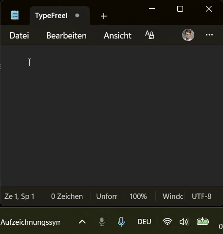

# typeFREE

System-wide dictation for Windows: hold a hotkey, speak, release, and the cleaned-up text appears in whatever
window has focus. I use it every day; most of my instructions to coding agents are dictated with it.

**Stack:** Python · `keyboard` (global hooks) · `sounddevice` · `pystray` · Win32 clipboard via `ctypes` ·
speech-to-text and LLM clean-up through OpenRouter · PyInstaller · pytest

## How it works

```
hold hotkey (default Alt+Ä) → microphone opens → audio stays in RAM
release → WAV in memory → speech-to-text → LLM clean-up → private clipboard → Ctrl+V into the active window
```

- **Speech-to-text as a provider chain**, chosen in `config.json`. The default runs entirely through OpenRouter:
  `mai-transcribe-1.5`, falling back to `whisper-large-v3-turbo`. The order comes from my own measurements on
  reference audio (word error rate and latency); the numbers and why models were dropped are documented next to
  the chain in `typefree.py`.
- **Clean-up** removes filler words and fixes punctuation. The prompt tells the model the text is *not* a
  question to answer. If the clean-up fails, the raw text is used.
- **Live mode:** text is typed block by block while you are still speaking; punctuation at a block boundary is held
  back until the next block shows whether the sentence goes on.
- **Tray icon** shows the state by colour (ready, recording, transcribing, cleaning up, error).

## Demo in Action



*System-wide dictation lifecycle shown above:*
1. **Idle (Grey Icon):** typeFREE waits quietly in the Windows system tray.
2. **Recording (Green Icon):** Hotkey pressed and held — live microphone capture into memory.
3. **Transcribing & Clean-Up (Orange / Blue Icon):** Speech-to-text API call followed by LLM punctuation and filler removal.
4. **Pasting at Cursor (Back to Grey):** Private clipboard paste directly into the active editor (`Notepad`).

## Decisions and lessons

- **Microphone only while the key is held**, and released before the API call.
- **No invented text from silence.** Models like to add subtitle credits or "Thank you." to silent audio.
  typeFREE cuts known trailers at the end and drops a dictation that is only that.
- **Private clipboard:** the text is written with the Windows flags that keep it out of clipboard history and
  cloud sync, and the previous clipboard content is restored afterwards.
- **Clipboard instead of key emulation:** typing character by character breaks on umlauts and keyboard layouts.
- **Hotkey pitfalls, now in code and tests:** a `suppress=True` hook that fails can block the whole keyboard;
  AltGr arrives as Ctrl+Alt; key repeat must not restart a recording; releasing the main key always ends the
  recording (`decide_hotkey_action`, a pure function under test).
- **Dead microphone detection:** a disconnected device delivers exact digital zeros, a real room never does.
- **No dictation is lost:** if transcription fails, the audio stays in memory and the tray offers a retry.
- **Fixed replacements** for recurring mishearings (`spoken => written`), without a model call.
- **Running cost per month** in the tray, booked with the price of the provider that actually answered.

## Run it

Windows only. `installer/setup.cmd` installs it for end users; for development:

```powershell
pip install -r windows/requirements.txt -r windows/requirements-dev.txt
python windows/typefree.py
python -m pytest -q windows/tests    # from the project folder; also run in CI
```

Parallel requests to the same speech-to-text provider share a single deadline. If the SDK times out on the remaining budget, typeFREE reports the overall deadline unless a non-transient provider error takes precedence.

The API key goes into a local `.env` (see `installer/ANLEITUNG-API-KEY.html`).

← [Back to overview](../../README.md)
