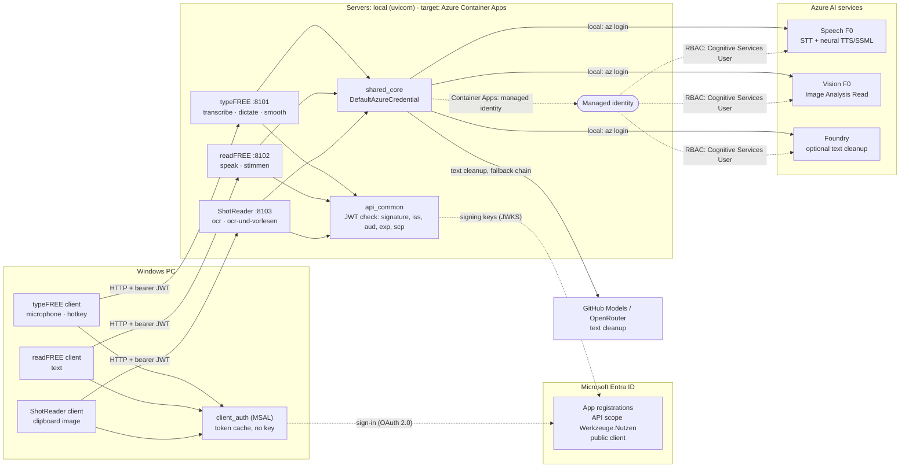

# Foundry demos for typeFREE, readFREE, and ShotReader

This folder contains three local client/server demonstrations backed by a shared Azure core. They are evaluation examples, not production services or an enterprise rollout. The original personal-purpose applications remain separate: those use user-configured OpenRouter routes; these demos use Azure AI Speech (F0) for speech recognition/synthesis and Azure AI Vision (F0) for image OCR. Text cleanup defaults to GitHub Models (`gpt-4o-mini`); OpenRouter and Azure AI Foundry are optional alternatives configured in the core.

The design goal is the enterprise pattern: **no key in any client**, Microsoft Entra ID for sign-in, and the server talking to Azure with its own identity.

## Architecture

Solid arrows are implemented in code and covered by the offline tests. Dashed arrows are the target design in Azure; the code is prepared for them, but they are not set up (see [What has been verified](#what-has-been-verified)).



## Authentication

**Server → Azure.** Entra ID is the default: `DefaultAzureCredential` (locally your `az login`, in Azure a managed identity). This holds even when a key is present in the environment. A key from `shared_core/.env` is used only with an explicit `AZURE_AUTH_MODE=key`. Note: Azure Speech and Vision accept Entra tokens only on resources with a **custom subdomain** and with an RBAC role such as *Cognitive Services User* for the calling identity. Without those, use the explicit key fallback.

**Client → server.** The clients hold no key and no secret. `shared_core/client_auth.py` signs the user in with MSAL (silently from the local token cache `%LOCALAPPDATA%\azure-portfolio\msal_cache.bin` first, otherwise interactively in the browser) and sends `Authorization: Bearer <access token>`. The server (`shared_core/api_common.py`) validates the token against the tenant's signing keys: RS256 only, issuer (v2), audience, expiry, and the permission `Werkzeuge.Nutzen` (`scp` or app role `roles`). Responses: 401 for a missing or invalid token, 403 for a missing permission, 503 when the signing keys cannot be fetched. v2 access tokens are expected (`requestedAccessTokenVersion = 2` in the API app registration manifest).

| Variable | Where | Meaning |
|---|---|---|
| `ENTRA_TENANT_ID` | server + client | directory (tenant) ID |
| `ENTRA_API_AUDIENCE` | server | expected token audience (`aud`) |
| `ENTRA_REQUIRED_SCOPE` | server | required permission, default `Werkzeuge.Nutzen` |
| `ENTRA_CLIENT_ID` | client | application ID of the public client registration |
| `ENTRA_API_SCOPE` | client | full scope, e.g. `api://<api-id>/Werkzeuge.Nutzen` |
| `AUTH_LOKAL_OFFEN` | server | only the exact value `1` opens the endpoints **without** Entra configuration (local development) |

Without Entra configuration and without `AUTH_LOKAL_OFFEN=1`, every Azure endpoint answers 503: closed by default. When Entra is configured, it always applies and the switch has no effect. `/healthz` reports the mode (`client_auth`: `entra` | `lokal_offen` | `nicht_konfiguriert`) and never key material.

## Requirements and configuration

Use Python 3.12 on Windows for the microphone, hotkey, and audio clients. From the repository root, create an environment and install the demo dependencies:

```powershell
py -3.12 -m venv .venv
.\.venv\Scripts\python.exe -m pip install -r tools/foundry-demos/shared_core/requirements_azure.txt -r tools/foundry-demos/requirements-dev.txt
```

Server settings go into `tools/foundry-demos/shared_core/.env` (create it yourself; it is not shipped). With Entra ID only endpoints and the region are needed, no keys:

```dotenv
AZURE_SPEECH_REGION=<your-speech-region>
AZURE_SPEECH_RESOURCE_ID=<resource-id-of-the-speech-resource>
AZURE_VISION_ENDPOINT=<https://<custom-subdomain>.cognitiveservices.azure.com/>
ENTRA_TENANT_ID=<your-tenant-id>
ENTRA_API_AUDIENCE=<api://your-api-id>
GITHUB_TOKEN=<your-github-models-token>
# Only as an explicit fallback for resources without a custom subdomain:
# AZURE_AUTH_MODE=key
# AZURE_SPEECH_KEY=<your-speech-key>
# AZURE_VISION_KEY=<your-vision-key>
```

The values above are placeholders. Never commit credentials. Provider availability does not imply a free allowance, spending cap, privacy guarantee, or cost monitoring; confirm current provider terms and limits before sending real data.

Azure resources, role assignments, and app registrations must already exist. `shared_core/bootstrap_azure_f0.py` provisions Azure resources and writes configuration, so it is deliberately not part of these setup commands. It has not been run as part of this demo verification.

## Run one demo

Run commands from the repository root in separate PowerShell terminals. Sign in first with `az login` (server identity). Each server defaults to loopback (`127.0.0.1`). For the client, set `ENTRA_TENANT_ID`, `ENTRA_CLIENT_ID`, and `ENTRA_API_SCOPE`; without an app registration, open a local server explicitly with `$env:AUTH_LOKAL_OFFEN = "1"` in the server terminal. Keep the server bound to loopback for local evaluation. Do not expose it to the internet or deploy it as-is.

### typeFREE

Terminal 1:

```powershell
.\.venv\Scripts\python.exe -m uvicorn TypeFree.server.main:app --app-dir tools/foundry-demos --port 8101
```

Terminal 2:

```powershell
.\.venv\Scripts\python.exe tools/foundry-demos/TypeFree/client/app.py --datei probe.wav
```

### readFREE

Terminal 1:

```powershell
.\.venv\Scripts\python.exe -m uvicorn ReadFree.server.main:app --app-dir tools/foundry-demos --port 8102
```

Terminal 2:

```powershell
.\.venv\Scripts\python.exe tools/foundry-demos/ReadFree/client/app.py "Hallo, ich lese vor."
```

### ShotReader

Terminal 1:

```powershell
.\.venv\Scripts\python.exe -m uvicorn shotReader.server.main:app --app-dir tools/foundry-demos --port 8103
```

Terminal 2:

```powershell
.\.venv\Scripts\python.exe tools/foundry-demos/shotReader/client/app.py
```

The clients target their matching loopback ports by default. Speech/audio, image OCR, and configured LLM calls reach the selected cloud provider; local server binding does not make those calls offline.

## Offline checks

From the repository root, enter `tools/foundry-demos` and run the offline tests (the same command runs in CI):

```powershell
Set-Location tools/foundry-demos
python -m pytest -q --disable-socket --allow-unix-socket --allow-hosts=localhost,127.0.0.1,::1 tests
```

| File | Covers |
|---|---|
| `tests/test_typefree.py` | dictation server (transcript, cleanup, raw-text fallback, 422/503) and client (sends WAV, token header, server error) |
| `tests/test_readfree.py` | read-aloud server (WAV, rate validation, voice list) and client (sends text, saves WAV, error paths) |
| `tests/test_shotreader.py` | OCR server (text, no text → no audio, OCR + speech) and client (sends image, saves audio) |
| `tests/test_auth.py` | Entra sign-in: JWT validation with a generated RSA test key, the `AUTH_LOKAL_OFFEN` switch, MSAL client with a stand-in |
| `tests/test_azure_free_core.py`, `tests/test_bootstrap_azure_f0.py` | SDK module (SSML, OCR lines, provider chain, auth selection) and bootstrap import without provisioning |
| `tests/test_gemeinsam.py` | `/healthz` of all three servers; the test network block is active |

Besides `pytest-socket`, `tests/conftest.py` blocks every non-loopback connection and name lookup, so a forgotten real Azure, Entra, or LLM call fails immediately.

## What has been verified

| Component | Offline with stand-ins (CI) | Live, local | Running in Azure |
|---|---|---|---|
| Speech to text, neural TTS with SSML, OCR | yes | yes, 10–11 Nov 2026, with the key fallback, before the Entra changes | no |
| Text cleanup through Foundry with `az login` (keyless) | yes | yes, 10 Nov 2026 | no |
| Server → Speech/Vision with Entra ID | yes (auth selection) | **no**: the F0 resources have no custom subdomain yet | no |
| Client → server with Entra ID (MSAL + JWT validation) | yes | **no**: no app registration yet | no |
| Managed identity, RBAC, Azure Container Apps | – | – | **no**, not set up |
| Container images | – | **no** (no Dockerfiles in this showcase) | – |
| typeFREE client microphone, hotkey, auto-paste | no | no | – |

These tests use stand-ins and do not require cloud calls. They do not verify real credentials, resource provisioning, live provider behavior, production cost controls, autoscaling, or deployment readiness.
